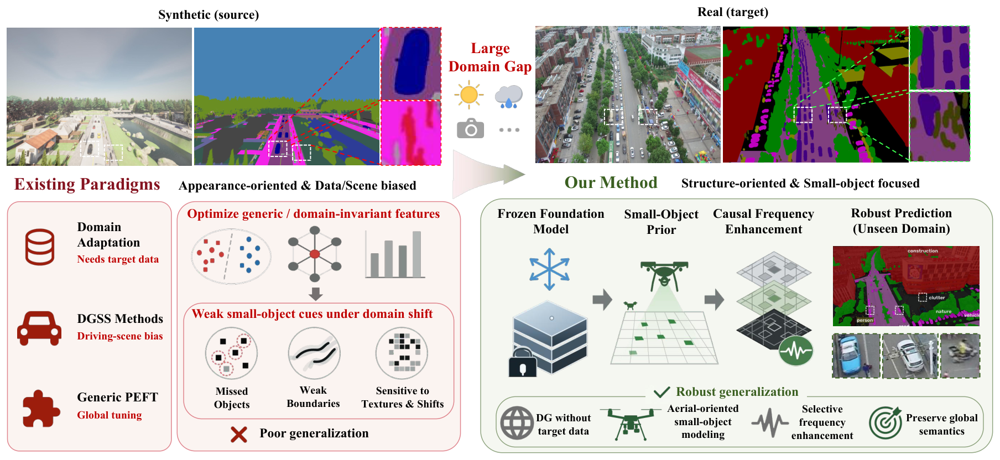
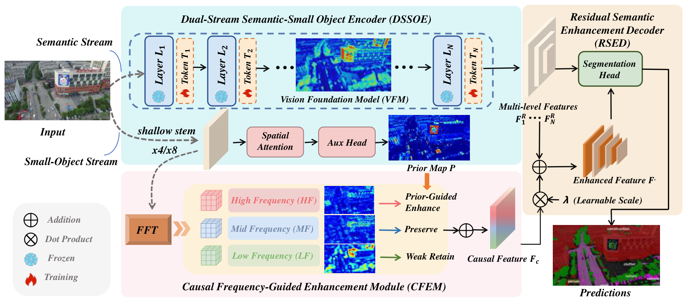
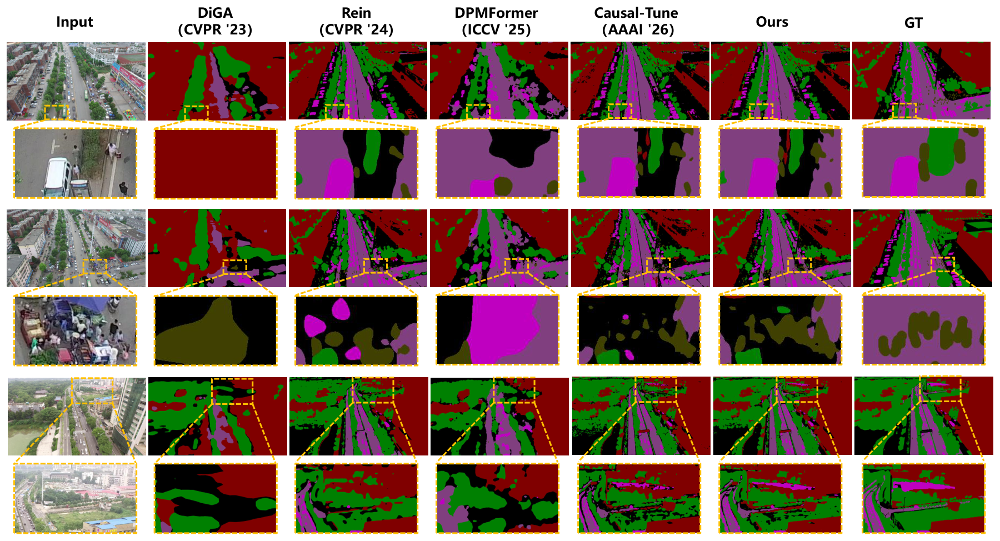
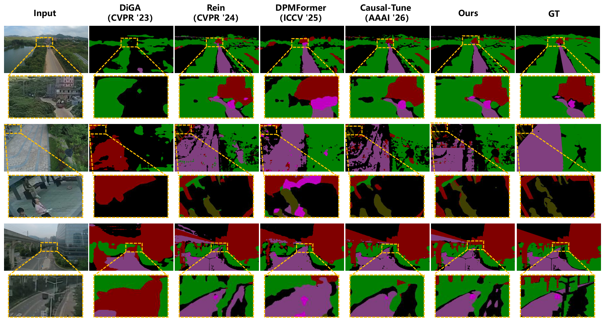

<h1 align="center">AeroCaSE: Causal-Inspired Small Object Enhancement for Synthetic-to-Real Domain Generalized Aerial Semantic Segmentation</h1>

  Qichen Tan1 · Yi Lin1 · Kexin Sun2 · Xun Jiang3
   
  1 Soochow University · 2 Sichuan University · 3 Tongji University

  
  
  
  
  

## Abstract

Synthetic aerial imagery offers scalable pixel-level supervision for semantic segmentation. When models trained on synthetic imagery are applied to real UAV scenes, small pedestrians and vehicles can be hard to distinguish from surrounding textures. AeroCaSE learns a shared spatial prior for person and vehicle regions from shallow, high-resolution features. The prior guides selective frequency enhancement, and learnable residual fusion integrates the enhanced cues into multi-level features from a frozen vision foundation model. Trained on SkyScenes and evaluated directly on two unseen real aerial benchmarks, AeroCaSE achieves **62.26% mIoU on UAVid** and **59.84% mIoU on AeroScapes**.

## Contributions

  
   
  Motivation. AeroCaSE preserves global semantics and selectively enhances small-object cues under domain shift.

- **Source-only aerial segmentation.** AeroCaSE is trained on synthetic SkyScenes and evaluated on two real aerial datasets, UAVid and AeroScapes.
- **Prior-guided frequency enhancement.** A class-agnostic prior for person and vehicle regions guides selective enhancement of fine details in shallow features. Learnable residual fusion incorporates those cues into the semantic stream.
- **Class- and region-level evaluation.** The experiments include comparisons with five baselines, area-stratified evaluation on UAVid, and comparisons across four foundation-model backbones.

## Method

  
   
  Overview of the AeroCaSE framework. Click the figure to open it at full resolution.

| Component | Role |
| --- | --- |
| **DSSOE** · Dual-Stream Semantic-Small Object Encoder | Adapts frozen vision foundation model features with learnable tokens. A shallow branch predicts a single-channel prior supervised by the merged person and vehicle masks. |
| **CFEM** · Causal Frequency-Guided Enhancement Module | Separates shallow features into three frequency bands, reconstructs them in the spatial domain, and uses the prior to selectively enhance high-frequency details. Mid-frequency structure is preserved and recalibrated, and low-frequency context is weakly retained. |
| **RSED** · Residual Semantic Enhancement Decoder | Integrates the enhanced features into multiple levels of the semantic stream through learnable residual scaling. A Mask2Former-style head produces the final segmentation. |

## Results

### Comparison with Existing Methods

Both settings use SkyScenes for training and six shared semantic classes for evaluation. All scores are percentages. **mAcc** is mean class-wise accuracy and **S-mIoU** is the mean of person and vehicle IoU.

#### SkyScenes → UAVid

| Method | mIoU ↑ | mAcc ↑ | S-mIoU ↑ |
| --- | ---: | ---: | ---: |
| RobustNet | 23.69 | 34.62 | 0.19 |
| DiGA | 32.37 | 44.02 | 11.23 |
| DPMFormer | 38.51 | 52.76 | 13.82 |
| Rein | 58.48 | 71.01 | 45.71 |
| Causal-Tune | 60.16 | 74.47 | 50.27 |
| **AeroCaSE** | **62.26** | **76.25** | **53.38** |

#### SkyScenes → AeroScapes

| Method | mIoU ↑ | mAcc ↑ | S-mIoU ↑ |
| --- | ---: | ---: | ---: |
| RobustNet | 32.90 | 47.75 | 34.69 |
| DiGA | 28.99 | 47.60 | 34.05 |
| DPMFormer | 46.58 | 67.09 | 34.37 |
| Rein | 55.12 | 71.59 | 67.19 |
| Causal-Tune | 56.51 | 74.07 | 71.87 |
| **AeroCaSE** | **59.84** | **76.02** | **76.89** |

### Visualization

The dashed boxes mark regions enlarged beneath each scene for comparison with the ground truth.

  
   
  Qualitative comparison on UAVid.

  
   
  Qualitative comparison on AeroScapes.

## Code Release

The [`core/`](core/) directory contains the AeroCaSE model components. The [`test.py`](test.py) entry point loads a checkpoint and evaluates segmentation predictions.

## License

Licensing information for the AeroCaSE implementation will be provided with the code release.

